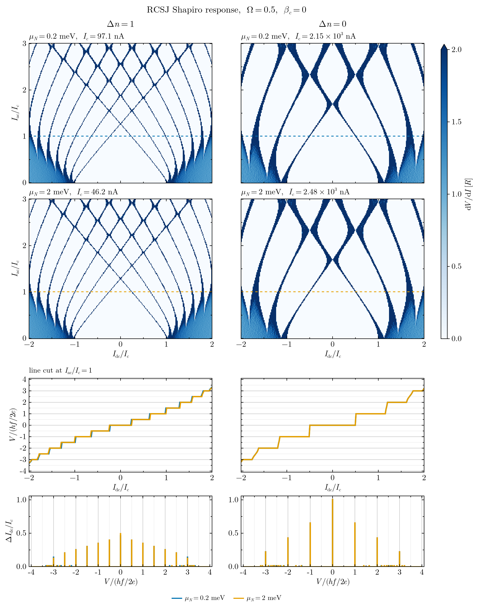

# Corbino

Numerical study of Corbino Josephson junctions: a ring-shaped normal region with induced superconductivity and fluxoids. It covers the flux spectrum, the free energy and current–phase relation, Fourier harmonics of the CPR, and Shapiro steps from an RCSJ model driven by the computed CPR.

The work builds on the model and code of [arXiv:2506.15502](https://arxiv.org/abs/2506.15502), *Solitonic Andreev spin qubits from Andreev states in Corbino Josephson junctions*.



## Contents

| File | What it does |
|---|---|
| `project.jl` | Analysis functions: free energy, Fourier/CPR analysis, flux spectrum, Shapiro cases, plotting, and saving/loading Shapiro runs |
| `rcsj.jl` | RSJ/RCSJ dynamics at T = 0 (needs only the normalized CPR, not Quantica); physical units |
| `test_rcsj.jl` | Validation of the Shapiro solver against known results: `julia --project -t auto test_rcsj.jl` |
| `figures.jl` | Driver script: sets parameters and produces the figures |
| `figures/` | Generated figures |

Main functions in `project.jl`:

- `detailed_fourier_analysis`, `sweep_vg_mu_harmonic_amplitudes`: harmonics of the free energy `F(ϕ)`
- `plot_flux_spectrum`: BdG spectrum against flux, with fluxoid winding bars
- `plot_free_energy_current`: `F(ϕ)` and the supercurrent for several cases
- `converged_cpr`, `normalize_cpr`: CPR harmonics (from the ground-state `F(ϕ)`), refined until converged
- `shapiro_case`: CPR of one case, then its Shapiro map; `scaling = :fixed` (given `βc`, `Ω`) or `:physical` (`βc`, `Ω` from the case's own `I_c` and `device = (; R, C, f)`, currents in µA)
- `shapiro_map`, `plot_shapiro_grid`: Shapiro maps of `βc φ̈ + φ̇ + I_s(φ)/I_c = i_dc + i_ac sin(Ωτ)` (`βc = 0` is plain RSJ), swept outward from `i_dc = 0` (switching) and back inward (retrapping); dV/dI and hysteresis maps, line cuts in units of `hf/2e` and step histograms
- `stroboscopic`: `φ mod 2π` once per drive period, to spot chaotic regions
- `save_shapiro_run`, `load_shapiro_run`, `list_shapiro_runs`, `combine_shapiro_runs`: store runs as JLD2 files in `data/shapiro_runs/`, with an `index.csv`, so they can be plotted again without recomputing

## Requirements

The Hamiltonian (`build`, `ES`, etc.) comes from the arXiv:2506.15502 code. Clone that repo **next to** this one:

```
parent/
├── Quartets/            ← this repo
└── arXiv_2506.15502/    ← git clone https://github.com/pablosanjose/arXiv_2506.15502
```

Julia 1.13 (the `Manifest.toml` was generated with it; older versions may need `] resolve`). The exact package versions, including those needed by the arXiv code, are recorded in `Project.toml` and `Manifest.toml`. To install them, run this from this folder:

```
julia --project
] instantiate
```

`Revise` is included because the files are loaded with `includet`.

## Usage

Start Julia from this folder with `julia --project` and run:

```julia
using Revise
include("figures.jl")
```

Edit the parameter blocks in `figures.jl` (`base_params`, `cpr_settings`, `device`, `shapiro_setups`) to change the run, and pick one of the Shapiro setups with `setup`:

1. RSJ baseline: `βc = 0`, `Ω = 0.5`
2. Capacitive control: `βc = 2.78`, `Ω = 1.8` (Kautz 1996, Fig. 13a), to tell capacitive half-integer steps from CPR ones
3. Physical scaling: one device (`R`, `C`, `f`), so every case gets its own `βc` and `Ω` from its `I_c`; plots in µA and `hf/2e`

Start Julia with threads (`julia --project -t auto`): the maps run in parallel over `I_ac`. The analyses that are commented out in `figures.jl` (Fourier sweeps, flux spectrum, free energy) can be switched back on as needed.

To reload saved Shapiro runs without recomputing:

```julia
list_shapiro_runs()
run = load_shapiro_run("20261021-153012")
plot_shapiro_grid(run.results, run.µs, run.Δns; iac_cut = 1.0)   # units = :physical for setup 3
```
