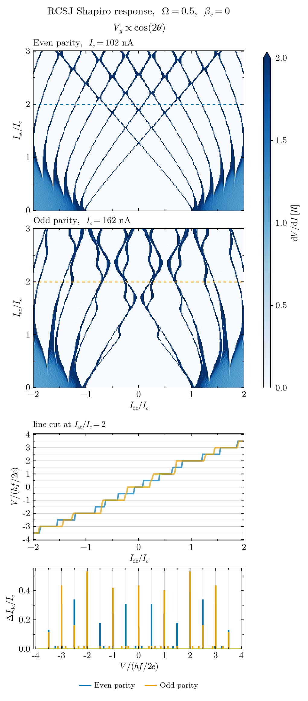

# Corbino

Numerical study of Corbino Josephson junctions: a ring-shaped normal region with induced superconductivity and fluxoids. It covers the flux spectrum, the free energy and current–phase relation, Fourier harmonics of the CPR, and Shapiro steps from an RCSJ model driven by the computed CPR.

The work builds on the model and code of [arXiv:2506.15502](https://arxiv.org/abs/2506.15502), *Solitonic Andreev spin qubits from Andreev states in Corbino Josephson junctions*.



## Contents

| File | What it does |
|---|---|
| `setup.jl` | Shared by the scripts: packages, `base_params`, `solver`, and the Shapiro setups (`shapiro_setups`, `device`) |
| `project.jl` | Physics and computation: free energy, Fourier/CPR harmonics, even/odd parity CPRs, Shapiro cases; loads all files below |
| `rcsj.jl` | RSJ/RCSJ dynamics at T = 0 (needs only the normalized CPR, not Quantica); physical units |
| `plots_cpr.jl` | Free energy, CPR and harmonic figures: `detailed_fourier_analysis`, `sweep_vg_mu_harmonic_amplitudes`, `plot_free_energy_current` |
| `plots_spectrum.jl` | `plot_flux_spectrum`: BdG spectrum against flux with fluxoid winding bars |
| `plots_shapiro.jl` | `plot_shapiro_grid` (and `latex_num`) |
| `shapiro_runs.jl` | Saving, loading and combining Shapiro runs |
| `fig_fourier.jl`, `fig_harmonics_map.jl`, `fig_spectrum.jl`, `fig_free_energy_current.jl`, `fig_shapiro.jl`, `fig_shapiro_parity.jl` | One script per figure, each with its own parameters |
| `test_rcsj.jl` | Validation of the Shapiro solver against known results: `julia --project -t auto test_rcsj.jl` |
| `test.jl`, `test_periodicity.jl`, `time_evo.jl` | Exploratory: soliton branches, 2π/4π periodicity scan, time evolution under a phase sweep (Landau–Zener) |
| `figures/` | Generated figures |
| `data/shapiro_runs/` | Saved Shapiro runs (JLD2) and their `index.csv` |

Main functions:

- `detailed_fourier_analysis`, `sweep_vg_mu_harmonic_amplitudes`: harmonics of the free energy `F(ϕ)`; the Fourier figure shows the ground state and the filled soliton (`F + E`)
- `plot_flux_spectrum`: BdG spectrum against flux, with fluxoid winding bars
- `spectrum_F0_tracked`: one dense spectrum over `ϕ`, giving the ground-state `F₀`, the tracked level `εt` (lowest positive at `φsel`, followed through the band connectivity) and the smallest Andreev level
- `plot_free_energy_current`: `F(ϕ)` and the supercurrent of one case, even (`F₀`) and odd (`F₀ + εt`) fermion parity, in meV
- `converged_cpr`, `converged_harmonics`: CPR harmonics converged by doubling the number of `ϕ` points (both use `doubling_harmonics`); `converged_cpr` computes the new points at each doubling, `converged_harmonics` subsamples a grid it already has
- `shapiro_case`: CPR of one case, then its Shapiro map; `scaling = :fixed` (given `βc`, `Ω`) or `:physical` (`βc`, `Ω` from the case's own `I_c` and `device = (; R, C, f)`, currents in µA)
- `shapiro_parity_cases`: Shapiro maps of the even and odd parity of one case, both CPRs from the same dense spectrum
- `shapiro_map`, `plot_shapiro_grid`: Shapiro maps of `βc φ̈ + φ̇ + I_s(φ)/I_c = i_dc + i_ac sin(Ωτ)` (`βc = 0` is plain RSJ), swept outward from `i_dc = 0` (switching) and back inward (retrapping); dV/dI and hysteresis maps, line cuts in units of `hf/2e` and step histograms. Rows and columns are µN and Δn values, or any text labels (e.g. parity, gate profile)
- `stroboscopic` (`rcsj.jl`): `φ mod 2π` once per drive period, to spot chaotic regions
- `save_shapiro_run`, `load_shapiro_run`, `list_shapiro_runs`, `combine_shapiro_runs`: store runs as JLD2 files in `data/shapiro_runs/`, with an `index.csv`, so they can be plotted again without recomputing

## Requirements

The Hamiltonian (`build`, `ES`, etc.) comes from the arXiv:2506.15502 code. Clone that repo **next to** this one:

```
parent/
├── Quartets/            ← this repo
└── arXiv_2506.15502/    ← git clone https://github.com/pablosanjose/arXiv_2506.15502
```

Julia 1.13 (the `Manifest.toml` was generated with it; older versions may need `] resolve`). The exact package versions, including those needed by the arXiv code, are recorded in `Project.toml` and `Manifest.toml`. To install them, run this from this folder:

```
julia --project
] instantiate
```

`Revise` is included because the files are loaded with `includet`.

## Usage

Start Julia from this folder with `julia --project` and run the script of the figure you want:

```julia
using Revise
include("fig_fourier.jl")          # or fig_spectrum.jl, fig_free_energy_current.jl, fig_harmonics_map.jl, fig_shapiro.jl, fig_shapiro_parity.jl
```

`base_params`, `solver` and the Shapiro setups are shared in `setup.jl`; each script sets its own `params` on top. There are two Shapiro scripts:

- `fig_shapiro.jl`: ground-state CPR, a grid of µN rows × Δn columns
- `fig_shapiro_parity.jl`: even and odd fermion parity of one case (rows), the column labelled by the gate profile `V_g ∝ cos(mult θ)`

Each script sets its own `cpr_settings` and picks one of the setups (defined in `shapiro_setups` in `setup.jl`) with `setup`:

1. RSJ baseline: `βc = 0`, `Ω = 0.5`
2. Capacitive control: `βc = 2.78`, `Ω = 1.8` (Kautz 1996, Fig. 13a), to tell capacitive half-integer steps from CPR ones
3. Physical scaling: one device (`R`, `C`, `f`), so every case gets its own `βc` and `Ω` from its `I_c`; plots in µA and `hf/2e`

Start Julia with threads (`julia --project -t auto`): the maps run in parallel over `I_ac`. 

To reload saved Shapiro runs without recomputing:

```julia
list_shapiro_runs()
run = load_shapiro_run("20261103-170959_parity_setup1")
plot_shapiro_grid(run.results, run.µs, run.Δns; iac_cut = 1.0)   # units = :physical for setup 3
```
