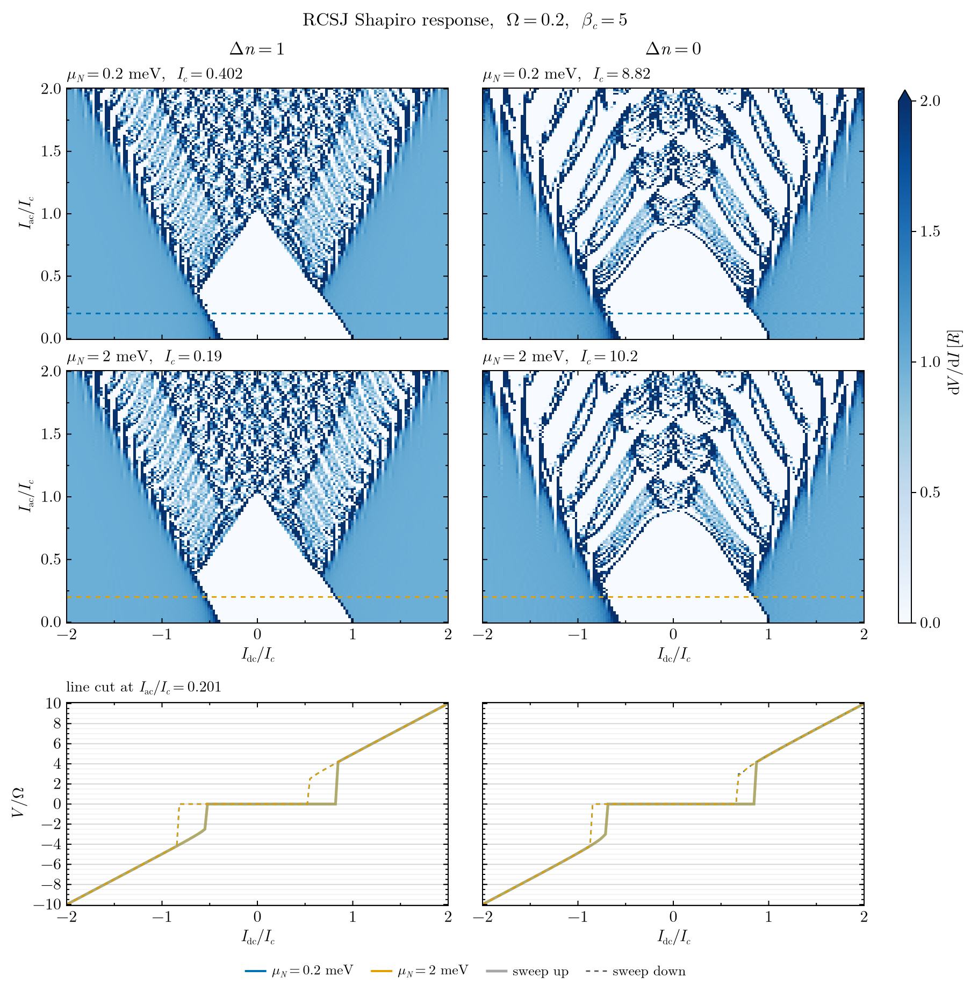

# Corbino

Numerical study of Corbino Josephson junctions: a ring-shaped normal region with induced superconductivity and fluxoids. It covers the flux spectrum, the free energy and current–phase relation, Fourier harmonics of the CPR, and Shapiro steps from an RCSJ model driven by the computed CPR.

The work builds on the model and code of [arXiv:2506.15502](https://arxiv.org/abs/2506.15502), *Solitonic Andreev spin qubits from Andreev states in Corbino Josephson junctions*.



## Contents

| File | What it does |
|---|---|
| `project.jl` | All analysis functions: free energy, Fourier/CPR analysis, flux spectrum, the RCSJ Shapiro solver, plotting, and saving/loading Shapiro runs |
| `figures.jl` | Driver script: sets parameters and produces the figures |
| `figures/` | Generated figures |

Main functions in `project.jl`:

- `detailed_fourier_analysis`, `sweep_vg_mu_harmonic_amplitudes`: harmonics of the free energy `F(ϕ)`
- `plot_flux_spectrum`: BdG spectrum against flux, with fluxoid winding bars
- `plot_free_energy_current`: `F(ϕ)` and the supercurrent for several cases
- `converged_cpr`, `normalize_cpr`: CPR harmonics, refined until converged
- `shapiro_map`, `plot_shapiro_grid`: RCSJ Shapiro maps, `βc φ̈ + φ̇ + I_s(φ)/I_c = i_dc + i_ac sin(Ωτ)`
- `save_shapiro_run`, `load_shapiro_run`, `list_shapiro_runs`, `combine_shapiro_runs`: store runs as JLD2 files in `data/shapiro_runs/`, with an `index.csv`, so they can be plotted again without recomputing

## Requirements

The Hamiltonian (`build`, `ES`, etc.) comes from the arXiv:2506.15502 code. Clone that repo **next to** this one:

```
parent/
├── Quartets/            ← this repo
└── arXiv_2506.15502/    ← git clone https://github.com/pablosanjose/arXiv_2506.15502
```

Julia 1.13 (the `Manifest.toml` was generated with it; older versions may need `] resolve`). The exact package versions, including those needed by the arXiv code, are recorded in `Project.toml` and `Manifest.toml`. To install them, run this from this folder:

```
julia --project
] instantiate
```

`Revise` is included because the files are loaded with `includet`.

## Usage

Start Julia from this folder with `julia --project` and run:

```julia
using Revise
include("figures.jl")
```

Edit the parameter blocks in `figures.jl` (`base_params`, `cpr_settings`, `drive`, `bias`, `device`) to change the run. The analyses that are commented out in `figures.jl` (Fourier sweeps, flux spectrum, free energy) can be switched back on as needed.

To reload saved Shapiro runs without recomputing:

```julia
list_shapiro_runs()
run = load_shapiro_run("20261021-153012")
plot_shapiro_grid(run.results, run.µs, run.Δns; iac_cut = 0.2)
```
